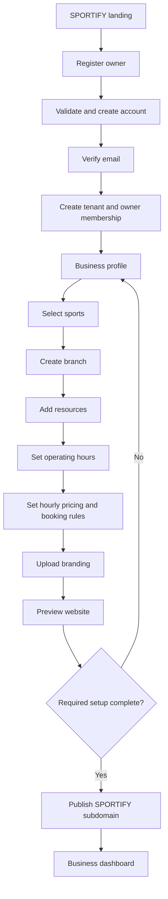
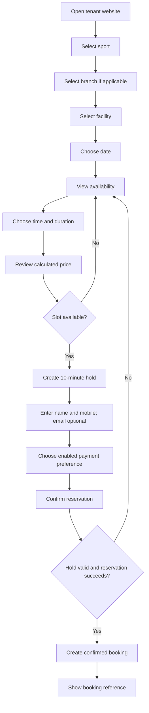
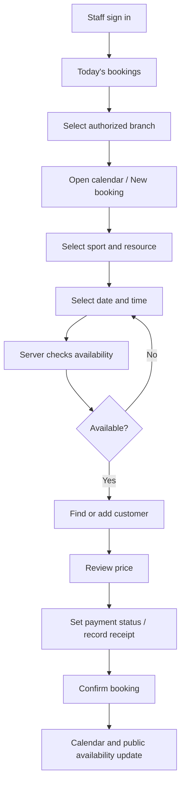
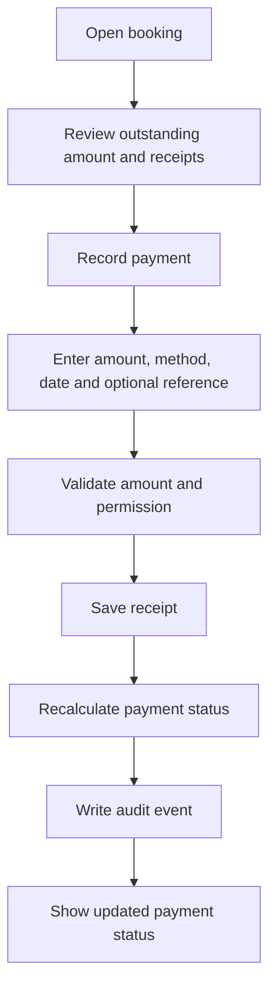
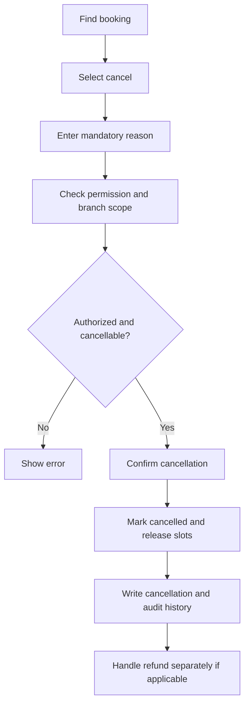
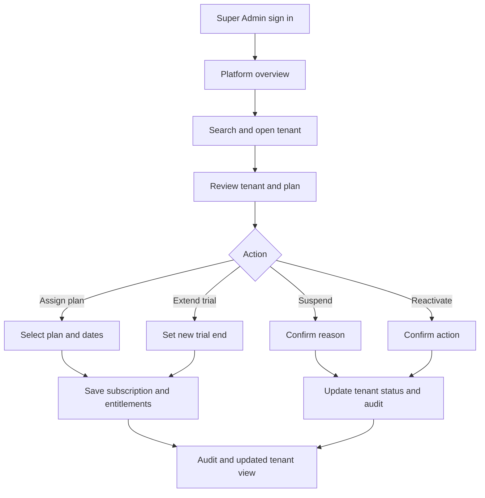

# SPORTIFY – UX Research, User Flows & Wireframes

**Document version:** 1.0  
**Date:** 15 November 2026  
**Status:** UX planning baseline – ready for stakeholder review  
**Product:** Multi-Tenant Indoor Sports Booking & Business Management SaaS  
**Reference baseline:** Master PRD v1.0; MVP Scope & Business Workflow Specification v1.0; Technical Architecture Specification v1.0; Oracle Database Schema Specification v1.0.

---

## 1. Purpose

This document translates the approved product and technical requirements into a screen-level experience for customers, business owners, business managers, receptionists and Super Admins. It defines information architecture, screen inventory, primary user journeys, low-fidelity wireframes, interaction rules and a validation plan.

**Research integrity:** This is a requirements-derived UX baseline. It does not claim that user interviews or usability tests have already been conducted. Personas and hypotheses below must be validated with actual users.

## 2. UX architecture and MVP boundaries

### 2.1 Four connected experiences

1. **Public SPORTIFY website:** explain the platform and convert business owners into registrants.
2. **Tenant booking website:** one responsive website template per business, served through its SPORTIFY subdomain.
3. **Business dashboard:** shared dashboard with navigation and actions controlled by role and branch assignment.
4. **Super Admin dashboard:** separate platform administration experience.

### 2.2 MVP decisions that affect the UX

- Guest booking is mandatory; customers do not need an account to reserve.
- Customer self-service cancellation is deferred. Customers see the cancellation policy and contact details; authorized staff perform MVP cancellations.
- The tenant website uses one responsive template with configurable branding. Drag-and-drop page building and multiple advanced themes are out of MVP.
- The MVP uses a SPORTIFY subdomain. Custom domains are Phase 2.
- The central sports marketplace is Phase 2. Initial customer booking starts on an individual business website.
- Venue payments are recorded manually: cash, bank transfer and card at venue. Online payment gateways are Phase 2.
- Booking confirmation does not depend on payment. A booking can be `CONFIRMED` while payment is `UNPAID`.
- Customer payment preference is not an online gateway checkout. Show only preferences enabled by the business, such as pay-at-venue or bank transfer.
- A 10-minute temporary hold is shown during checkout. If it expires, the customer must recheck availability.
- The booking grid uses 15-minute units. Initial suggested defaults: 60-minute minimum, 180-minute maximum, zero buffer; configurable booking rules apply.
- Online and manual bookings use the same reservation engine. Manual bookings update public availability immediately.
- MVP business roles: Business Owner, Business Manager and Receptionist. Branch assignment and backend permission enforcement are required.
- Super Admin MVP: tenant search/status, sports catalog, plan configuration/assignment, platform statistics and important audit records. Advanced support management and marketplace moderation are excluded.

## 3. UX research brief

### 3.1 Research objectives

- Verify whether a first-time owner can understand and complete the setup wizard.
- Learn how staff currently handle availability and telephone, WhatsApp and walk-in bookings.
- Verify whether customers understand the sport → branch → resource → date/time → guest details sequence.
- Test whether customers notice the hold countdown and understand expiry.
- Confirm that payment preference and booking confirmation are clearly distinguished.
- Check whether staff can find a booking, record a receipt and cancel with a reason.
- Confirm that Super Admin can identify a tenant and safely change its status or subscription.

### 3.2 Requirements-derived proto-personas

| Persona | Primary goal | UX needs |
|---|---|---|
| Customer / Guest | Reserve a facility without calling | Mobile-first, visible availability and total, short guest checkout, clear confirmation |
| Business Owner | Launch and control a sports business | Guided setup, save/resume, publish checklist, business overview |
| Business Manager | Run daily operations | Fast calendar, search/filter, branch context, facility controls |
| Receptionist | Handle walk-ins, calls and WhatsApp requests | Short manual booking flow, clear availability, quick payment recording |
| Super Admin | Operate the SaaS platform | Tenant search, plan/status controls, confirmation for sensitive actions, audit trail |

### 3.3 Research hypotheses (not validated findings)

1. Owners may not know which setup details are essential to publish; separate required from optional fields.
2. Receptionists may prioritize a fast calendar and manual booking action over charts.
3. Customers may abandon checkout if price, payment preference or the hold timer is unclear.
4. Branch/resource selection may be confusing for single-branch venues; hide unnecessary choices.
5. Staff may confuse booking status with payment status; always display them separately.

### 3.4 Suggested research sample and method

| Participant group | Suggested sample | Method |
|---|---:|---|
| Sports business owners | 5–6 | 30–45 minute interview and onboarding prototype task |
| Receptionists / managers | 4–5 | Workflow observation and manual booking task |
| Customers | 6–8 | Mobile booking usability test |
| Platform administrator | 1–2 if available | Tenant and subscription administration task |

Recruit a mix of futsal, badminton and indoor cricket businesses, including single-branch and multi-branch operators. This is a proposed research plan, not completed research.

## 4. UX principles

- Booking first: make availability and booking the clearest customer action.
- Mobile-first customer journey.
- Operational speed for receptionists.
- Progressive onboarding with save-and-resume.
- One source of truth: online and manual bookings share the same reservation engine.
- Clear status language: booking and payment status remain separate.
- No surprise: show price, duration, cancellation policy and payment preference before confirmation.
- Permission-aware navigation; server authorization remains mandatory.
- Accessible labels, keyboard support, sufficient contrast, touch targets and non-colour status cues.
- English, Sinhala and Tamil core UI; initial defaults LKR and `Asia/Colombo`, with tenant-configured values respected.

## 5. Information architecture

### 5.1 Public SPORTIFY navigation
Home • How it works • For sports businesses • Plans • Sign in • Get started.

### 5.2 Tenant booking website navigation
Business logo/name • Home • Facilities • Contact/Location • Book now. Do not add the central marketplace to MVP navigation.

### 5.3 Business dashboard navigation

**Owner / Manager:** Overview • Bookings • Branches • Sports • Facilities • Operating hours & closures • Pricing • Customers • Payments • Staff • Website • Reports • Subscription.

**Receptionist:** Overview / Today's bookings • Bookings • Customers • Payments. Restrict to assigned branches and permitted operations. Do not show subscription, staff administration, platform settings or business configuration links.

### 5.4 Super Admin navigation
Overview • Businesses/Tenants • Sports catalog • Subscription plans • Audit records.

### 5.5 Global dashboard layout
- Top bar: SPORTIFY mark, current business, branch selector where permitted, profile menu.
- Left navigation: role-specific modules.
- Main content: page title, primary action, filters and content.
- Mobile: collapsible navigation drawer; keep the primary task action accessible.

## 6. Screen inventory

Priority: **P0** = critical path; **P1** = supporting MVP; **FUT** = future phase.

| ID | Screen | Actor | Scope | Purpose |
|---|---|---|---|---|
| PUB-01 | SPORTIFY marketing landing | Prospective owner | P1 | Platform overview, benefits, sports, sign-in and registration CTA. |
| PUB-02 | Business registration | Owner | P0 | Business name, owner, email, mobile, password, location and primary sport. |
| AUTH-01 | Sign in | All roles | P0 | Secure sign-in and role-based redirect. |
| AUTH-02 | Email verification | Owner / invited staff | P0 | Verification status, resend and next step. |
| AUTH-03 | Forgot/reset password | All roles | P1 | Request reset and set a new password. |
| ONB-01 | Business profile setup | Owner | P0 | Business profile/contact fields; autosave and resume. |
| ONB-02 | Select sports | Owner | P0 | Choose sports from central catalog. |
| ONB-03 | Create first branch | Owner | P0 | Create first business location. |
| ONB-04 | Add facilities/resources | Owner | P0 | Create courts, nets, tables, lanes and other resources. |
| ONB-05 | Operating hours | Owner | P0 | Set branch/resource operating days and hours. |
| ONB-06 | Pricing and booking rules | Owner | P0 | Hourly rate, min/max duration, advance window and hold settings. |
| ONB-07 | Website branding | Owner | P0 | Upload logo/cover and configure supported branding. |
| ONB-08 | Preview and publish | Owner | P0 | Preview single template and publish SPORTIFY subdomain. |
| TEN-01 | Tenant website home | Customer / guest | P0 | Business intro, sports, facilities, prices, hours, location and booking CTA. |
| TEN-02 | Sport/branch/facility selection | Customer / guest | P0 | Select sport, branch if needed, and resource. |
| TEN-03 | Availability/date/time/duration | Customer / guest | P0 | Choose date, eligible slot, start time and duration. |
| TEN-04 | Guest details and review | Customer / guest | P0 | 10-minute hold timer, name/mobile, optional email, payment preference and total. |
| TEN-05 | Booking confirmation | Customer / guest | P0 | Reference, venue, branch, resource, date/time, price, payment status and policy. |
| DASH-01 | Business overview | Owner / manager; limited staff | P0 | Today's/upcoming/completed/cancelled/unpaid counts, booking value and collected payments. |
| BOOK-01 | Booking calendar and list | Owner / manager / receptionist | P0 | Daily/weekly/facility views, date/branch/facility filters and search. |
| BOOK-02 | Booking details | Owner / manager / receptionist | P0 | Customer, resource, date/time, amount, statuses and permitted actions. |
| BOOK-03 | Create manual booking | Owner / manager / receptionist | P0 | Select branch/resource/time, customer, price and payment; same booking engine. |
| BOOK-04 | Cancel booking with reason | Authorized staff | P0 | Confirm cancellation and require reason; refund separate. |
| PAY-01 | Record payment | Owner / manager / receptionist | P0 | Cash, bank transfer or card-at-venue receipt, amount, date and optional reference. |
| PAY-02 | Payment history / unpaid bookings | Owner / manager / receptionist | P1 | View receipts and unpaid bookings within permitted branch scope. |
| CUST-01 | Customer search/profile | Owner / manager / receptionist | P1 | Search tenant customer directory and permitted history. |
| LOC-01 | Branch list and form | Owner / manager | P1 | Create/edit business branches and location details. |
| SPORT-01 | Business sports selection | Owner / manager | P1 | Enable sports from global catalog. |
| RES-01 | Resource list and form | Owner / manager | P1 | Manage courts/nets/tables/lanes, photos, capacity, branch and status. |
| SCHED-01 | Operating hours | Owner / manager | P1 | Configure weekdays and opening/closing times. |
| SCHED-02 | Holidays and availability blocks | Owner / manager | P1 | Add closures/maintenance; show conflicts before saving. |
| PRICE-01 | Resource hourly pricing | Owner / manager | P1 | Set hourly rate and preview booking price. |
| WEB-01 | Website settings | Owner / manager | P1 | Edit logo, cover, description, contact, address, map, social links, hours and policy. |
| WEB-02 | Website preview/publish | Owner / manager | P1 | Preview one template and publish/update SPORTIFY subdomain. |
| STAFF-01 | Staff list and invitation | Business owner | P0 | Invite, assign Owner/Manager/Receptionist role and branch scope; activate/deactivate. |
| REPORT-01 | Basic reports | Owner / manager; restricted receptionist | P1 | Daily/weekly/monthly bookings, revenue by branch/facility, bookings by sport and cancellations. |
| SUB-01 | Current plan and trial | Business owner | P1 | View current plan, trial/expiry, limits and manual renewal/payment instructions. |
| ADMIN-01 | Super Admin overview | Super Admin | P1 | Platform statistics and important activity. |
| ADMIN-02 | Tenant/business list | Super Admin | P0 | Search tenants, filter status and open tenant details. |
| ADMIN-03 | Tenant details/status | Super Admin | P0 | Activate, suspend or reactivate a tenant. |
| ADMIN-04 | Sports catalog | Super Admin | P0 | Add/edit/deactivate global sports categories. |
| ADMIN-05 | Subscription plan management | Super Admin | P0 | Create plans and configure feature/branch/resource limits. |
| ADMIN-06 | Assign plan / extend trial | Super Admin | P0 | Assign subscription, set dates, extend trial and record manual subscription payment. |
| ADMIN-07 | Audit records | Super Admin | P1 | View important platform and tenant audit events. |
| FUT-01 | Central sports marketplace | Customer | FUT | Search venues by sport, location, price and availability. |
| FUT-02 | Custom domain setup | Owner | FUT | Submit/verify custom domain, DNS and SSL status. |
| FUT-03 | Online payment gateway | Customer | FUT | Gateway checkout and verified callbacks. |
| FUT-04 | Customer account/self-service cancellation | Customer | FUT | Registered profile, booking history and self-service cancellation. |
| FUT-05 | Advanced website builder | Owner | FUT | Drag-and-drop page builder and multiple themes. |
| FUT-06 | Recurring bookings/membership/reviews | Customer / business | FUT | Recurring reservations, membership and reviews. |

## 7. Core user flows

### 01 Business Owner Onboarding



### 02 Customer Booking



### 03 Receptionist Manual Booking



### 04 Payment Recording



### 05 Booking Cancellation



### 06 Super Admin Tenant Subscription



### 7.1 Customer booking interaction rules

- Hide branch selection if there is only one branch.
- Show date, local time, duration, hourly rate and total before collecting customer details.
- Start the 10-minute countdown only after the hold has been successfully created.
- If a hold expires or a conflict occurs, explain that the slot is no longer held and return to availability.
- Guest checkout requires customer name and mobile; email is optional.
- Show only payment preferences enabled by the business.
- Do not display a card gateway checkout in MVP.
- A successful reservation may be `CONFIRMED` while payment remains `UNPAID`.

### 7.2 Booking and payment status language

| Booking status | Customer/staff label |
|---|---|
| HELD | Temporarily held |
| CONFIRMED | Confirmed |
| CANCELLED | Cancelled |
| COMPLETED | Completed |
| NO_SHOW | No-show |
| EXPIRED | Hold expired |

| Payment status | Label |
|---|---|
| UNPAID | Unpaid |
| PAID | Paid |
| REFUNDED | Refunded |

Do not use one combined status badge to represent both booking and payment.

## 8. Low-fidelity wireframes

These are structural wireframes, not final visual designs. They define hierarchy, content groups and primary actions. Final spacing, visual styling and detailed component states are refined in Figma after review.

### WF-01 Customer tenant home (mobile)

```text
┌──────────────────────────────┐
│ [LOGO] COLOMBO FUTSAL        │
├──────────────────────────────┤
│         [COVER IMAGE]        │
│ Book your next game          │
│ Indoor futsal in Colombo     │
│ [ BOOK A COURT ]             │
├──────────────────────────────┤
│ OUR FACILITIES               │
│ ┌──────────────────────────┐ │
│ │ Court 01  From LKR ...  │ │
│ │ [View availability]     │ │
│ └──────────────────────────┘ │
│ ┌──────────────────────────┐ │
│ │ Court 02  From LKR ...  │ │
│ │ [View availability]     │ │
│ └──────────────────────────┘ │
├──────────────────────────────┤
│ Hours • Address • Map        │
│ Contact • Cancellation policy│
└──────────────────────────────┘
```

### WF-02 Sport and facility selection (mobile)

```text
┌──────────────────────────────┐
│ ← COLOMBO FUTSAL             │
│ Step 1 of 3                  │
├──────────────────────────────┤
│ Choose a sport               │
│ [ Futsal ] [ Badminton ]     │
│ Branch [ Colombo ▼ ]         │
│ Choose a facility            │
│ ┌──────────────────────────┐ │
│ │ Court 01                 │ │
│ │ Capacity • Features      │ │
│ │ LKR ____ / hour          │ │
│ │ [ SELECT ]               │ │
│ └──────────────────────────┘ │
│ ┌──────────────────────────┐ │
│ │ Court 02                 │ │
│ │ LKR ____ / hour          │ │
│ │ [ SELECT ]               │ │
│ └──────────────────────────┘ │
└──────────────────────────────┘
```

### WF-03 Availability and duration (mobile)

```text
┌──────────────────────────────┐
│ ← Select date & time         │
├──────────────────────────────┤
│ Court 01                     │
│ [<] November 2026 [>]        │
│ [Date calendar]              │
│ Available times              │
│ [7:00] [8:00] [9:00]         │
│ Duration [ - ] 60 min [ + ]  │
│ Estimated total: LKR 5,000   │
│ [ CONTINUE ]                 │
└──────────────────────────────┘
```

### WF-04 Guest details and review (mobile)

```text
┌──────────────────────────────┐
│ Slot held • 09:42 remaining  │
├──────────────────────────────┤
│ Review your booking          │
│ Court 01 • 20 Nov            │
│ 7:00–8:00 PM • LKR 5,000     │
├──────────────────────────────┤
│ [ Customer name           ]  │
│ [ Mobile number           ]  │
│ [ Email (optional)        ]  │
│ Payment preference           │
│ ( ) Pay at venue             │
│ ( ) Bank transfer            │
│ Cancellation policy          │
│ [ CONFIRM BOOKING ]          │
└──────────────────────────────┘
```

### WF-05 Booking confirmation (mobile)

```text
┌──────────────────────────────┐
│              ✓               │
│       BOOKING CONFIRMED      │
│ Reference: SPT-XXXXXX        │
├──────────────────────────────┤
│ Business / Branch / Facility │
│ Date / Start / End time      │
│ Total: LKR 5,000             │
│ Payment: UNPAID              │
│ Cancellation policy          │
│ Contact details              │
│ [ DONE ]                     │
└──────────────────────────────┘
```

### WF-06 Business dashboard (desktop)

```text
┌──────────────────────────────────────────────────────────────────┐
│ SPORTIFY  Business ▼   Branch: All ▼                     Profile │
├──────────────┬───────────────────────────────────────────────────┤
│ Overview     │ Business overview                                 │
│ Bookings     │ ┌─────────┐ ┌─────────┐ ┌─────────┐ ┌───────────┐ │
│ Branches     │ │ Today   │ │Upcoming │ │ Unpaid  │ │ Collected │ │
│ Sports       │ │ 12      │ │ 28      │ │ 4       │ │ LKR ...   │ │
│ Facilities   │ └─────────┘ └─────────┘ └─────────┘ └───────────┘ │
│ Hours/Blocks │ Upcoming bookings                                 │
│ Pricing      │ Time | Facility | Customer | Status | Action      │
│ Customers    │                                                   │
│ Payments     │ Booking / payment summary                          │
│ Staff        │                                                   │
│ Website      │                                                   │
│ Reports      │                                                   │
│ Subscription │                                                   │
└──────────────┴───────────────────────────────────────────────────┘
```

### WF-07 Booking calendar (desktop)

```text
┌──────────────────────────────────────────────────────────────────┐
│ SPORTIFY / Bookings       Branch ▼       [New manual booking]    │
├──────────────┬───────────────────────────────────────────────────┤
│ Dashboard    │ Bookings                                          │
│ Bookings     │ [Date] [Facility] [Search] [Day] [Week]           │
│ Facilities   │                    TIME GRID                     │
│ Customers    │             7:00  8:00  9:00  10:00               │
│ Payments     │ Court 01  [BOOKED] [FREE] [BLOCKED]               │
│ Staff        │ Court 02  [FREE]   [BOOKED] [FREE]                │
│ Website      │ Legend: Confirmed / Available / Maintenance       │
│ Reports      │                                                   │
└──────────────┴───────────────────────────────────────────────────┘
```

### WF-08 Booking details (desktop)

```text
┌──────────────────────────────────────────────────────────────────┐
│ Bookings / SPT-XXXXXX                 CONFIRMED • UNPAID          │
├──────────────────────────────────────────────────────────────────┤
│ Customer details           Facility & time                        │
│ Name / Mobile / Email      Court 01 • 20 Nov • 7–8 PM             │
├──────────────────────────────────────────────────────────────────┤
│ Total LKR 5,000            Paid LKR 0 • Outstanding LKR 5,000     │
│ Payment history            No receipts yet                        │
├──────────────────────────────────────────────────────────────────┤
│ [Record payment] [Cancel] [Mark completed] [No-show]             │
└──────────────────────────────────────────────────────────────────┘
```

### WF-09 Manual booking (desktop)

```text
┌──────────────────────────────────────────────────────────────────┐
│ Create manual booking                                             │
├──────────────────────────────────────────────────────────────────┤
│ 1 Facility & time  →  2 Customer  →  3 Confirm                   │
│ Branch [Colombo ▼] Sport [Futsal ▼] Facility [Court 01 ▼]        │
│ Date [20 Nov] Start [7:00 PM] Duration [60 min]                   │
│ Availability: ✓ Available     Total: LKR 5,000                   │
│ Customer [Search existing / Add new]                              │
│ Name [______________] Mobile [______________]                     │
│ Payment status [Unpaid ▼]                                         │
│                         [Cancel] [Confirm booking]                │
└──────────────────────────────────────────────────────────────────┘
```

### WF-10 Owner onboarding (desktop)

```text
┌──────────────────────────────────────────────────────────────────┐
│ SPORTIFY Setup Wizard                               Save and exit │
├─────────────────────┬────────────────────────────────────────────┤
│ 1 Business profile  │ Business profile                           │
│ 2 Sports            │ Business name [_______________________]    │
│ 3 Branch            │ Description  [_______________________]    │
│ 4 Facilities        │ Mobile       [_______________________]    │
│ 5 Operating hours   │ Email        [_______________________]    │
│ 6 Pricing/rules     │ Address      [_______________________]    │
│ 7 Branding          │                                            │
│ 8 Preview/publish   │ Progress saved automatically              │
│                     │                  [Save & continue]          │
└─────────────────────┴────────────────────────────────────────────┘
```

### WF-11 Facility management (desktop)

```text
┌──────────────────────────────────────────────────────────────────┐
│ Facilities and resources                              [Add]      │
├──────────────────────────────────────────────────────────────────┤
│ Branch [All ▼] Sport [All ▼] Status [All ▼] Search [________]    │
│ Name       Sport      Branch      Hourly rate    Status   Action  │
│ Court 01   Futsal     Colombo     LKR ____       Active   Edit    │
│ Court 02   Futsal     Colombo     LKR ____       Active   Edit    │
│ Net 01     Cricket    Gampaha     LKR ____       Active   Edit    │
└──────────────────────────────────────────────────────────────────┘
```

### WF-12 Website settings (desktop)

```text
┌──────────────────────────────────────────────────────────────────┐
│ Website settings                  tenant.sportify.lk  [Published]│
├─────────────────────┬────────────────────────────────────────────┤
│ Business details    │ Logo [Upload] Cover [Upload]                │
│ Sports              │ Description [___________________________]  │
│ Facilities          │ Brand colour [____]                         │
│ Contact & location  │ Phone [________] Address [_______________] │
│ Opening hours       │ Map [____________] Social links [_________] │
│ Booking policy      │ Website preview                              │
│                     │ [Preview frame of single responsive theme] │
│                     │ [Save draft] [Preview] [Publish / Update]   │
└─────────────────────┴────────────────────────────────────────────┘
```

### WF-13 Staff management (desktop)

```text
┌──────────────────────────────────────────────────────────────────┐
│ Staff and access                                    [Invite staff]│
├──────────────────────────────────────────────────────────────────┤
│ Name    Email        Role             Branches          Status     │
│ Nimal   n@...        Manager          Colombo           Active     │
│ Amal    a@...        Receptionist     Colombo           Active     │
│ Saman   s@...        Receptionist     Gampaha           Active     │
├──────────────────────────────────────────────────────────────────┤
│ Invite: Email [________] Role [Receptionist ▼]                   │
│ Branch scope [Colombo □] [Gampaha □] [Send invitation]           │
└──────────────────────────────────────────────────────────────────┘
```

### WF-14 Basic reports (desktop)

```text
┌──────────────────────────────────────────────────────────────────┐
│ Reports                    Period [Monthly ▼] Branch [All ▼]     │
├──────────────────────────────────────────────────────────────────┤
│ Booking value       Payments collected      Cancelled bookings   │
│ LKR ...             LKR ...                 ...                  │
│ Bookings by sport              Revenue by branch / facility      │
│ [Simple chart]                 [Simple chart]                    │
│ Daily / Weekly / Monthly detail                                  │
└──────────────────────────────────────────────────────────────────┘
```

### WF-15 Super Admin tenants (desktop)

```text
┌──────────────────────────────────────────────────────────────────┐
│ SPORTIFY ADMIN                                                    │
├─────────────────────┬────────────────────────────────────────────┤
│ Overview            │ Businesses / Tenants                        │
│ Businesses          │ Search [________________] Status [All ▼]   │
│ Sports catalog      │ Business      Owner      Plan      Status   │
│ Subscription plans  │ Colombo Futsal ...       Trial     Active   │
│ Audit records       │ Badminton Pro ...        Basic     Active   │
│                     │ Cricket Arena ...        Trial     Susp.    │
│                     │ [View] [Suspend / Reactivate]               │
└─────────────────────┴────────────────────────────────────────────┘
```

### WF-16 Super Admin plans (desktop)

```text
┌──────────────────────────────────────────────────────────────────┐
│ Subscription plans                                [Create plan]  │
├─────────────────────┬────────────────────────────────────────────┤
│ Overview            │ Plan name [________________]                │
│ Businesses          │ Price [________] Currency [LKR]            │
│ Sports catalog      │ Billing interval [Monthly ▼]                │
│ Subscription plans  │ Limits: Branches [__] Resources [__] Staff  │
│ Audit records       │ Entitlements [___________________________]  │
│                     │                           [Save plan]       │
└─────────────────────┴────────────────────────────────────────────┘
```

## 9. Role and permission-aware UX

| Module / action | Owner | Manager | Receptionist | Super Admin |
|---|---|---|---|---|
| Business overview | Full | Operational | Today / bookings | Platform overview |
| View bookings | All business | Authorized branches | Assigned branches | No routine tenant booking access |
| Create manual booking | Yes | Yes | Yes | No |
| Cancel booking | Yes | Yes | If permitted | No routine action |
| Record venue payment | Yes | Yes | Yes | No |
| Manage branches/resources | Yes | As authorized | No | No |
| Manage staff | Yes | Restricted if granted | No | No |
| Website settings/publish | Yes | As authorized | No | No |
| Basic reports | Yes | Yes | Restricted | Platform statistics |
| Subscription settings | View own | View if allowed | No | Manage |
| Tenant status / global sports / plans | No | No | No | Yes |

This is the UX presentation of MVP role boundaries. Exact permission codes must match backend permission seed data and branch assignments before implementation.

## 10. Interaction states and validation

Every key screen must define loading, empty, error, success and permission-denied states. Network retry behavior should be clear.

| Situation | Required feedback |
|---|---|
| Available slot | Selectable slot |
| Unavailable slot | Disabled slot and explanation |
| Active hold | Held by current checkout with countdown |
| Hold expired | Explain expiry and offer availability recheck |
| Booking conflict | Explain slot was just taken and refresh availability |
| Confirmed / unpaid | Booking is confirmed; payment remains due |
| Cancelled | Booking cancelled; history preserved; refund separate |
| Maintenance block | Facility unavailable for that period |

Form rules:
- Validate required fields inline and on the server.
- Preserve customer-entered data after a slot conflict where safe.
- Require a cancellation reason.
- Show outstanding amount and prior receipts before payment entry.
- Warn before leaving unsaved configuration.
- Do not rely on colour alone to convey status.

## 11. Responsive design

**Customer website:** mobile-first from 360px; one-column facility cards on narrow screens; touch-friendly calendar/time slots; sticky booking CTA only if it does not obscure content.

**Business dashboard:** desktop-first at 1280px, usable at 768px and 360px; collapse sidebar to drawer; convert dense tables to cards or controlled horizontal scrolling; provide agenda/list mode for calendar on narrow screens.

**Super Admin:** desktop-first; tenant search and status actions remain usable on tablet; sensitive actions require confirmation.

## 12. Localization and accessibility

- English, Sinhala and Tamil for core MVP interfaces.
- Use configured tenant timezone; initial default `Asia/Colombo`.
- Use configured currency; initial Sri Lankan default LKR.
- Keep translation strings outside UI components.
- Use semantic headings, field labels and keyboard focus indicators.
- Aim for WCAG 2.2 AA contrast.
- Use at least 44×44 CSS px touch targets for primary touch controls.
- Provide text labels for status; never rely on colour alone.
- Provide accessible names for calendar dates and time slots.

## 13. Usability validation plan

Tasks:
1. Owner registers and publishes a basic website.
2. Owner adds a facility and sets its price.
3. Customer books a one-hour slot as a guest.
4. Customer explains the 10-minute hold and unpaid confirmation.
5. Receptionist creates a walk-in booking.
6. Receptionist records a cash/bank-transfer payment.
7. Authorized staff cancel a booking with a reason.
8. Manager filters bookings by branch and date.
9. Super Admin finds a tenant and extends its trial.
10. Super Admin suspends and reactivates a test tenant.

Proposed usability goals (not measured results):
- At least 90% of participants complete primary tasks without moderator intervention.
- No participant mistakes an unpaid booking for a paid booking.
- No conflicting booking succeeds in concurrency tests.
- At least 90% of receptionists find the manual booking action without help.
- Owners can leave and resume onboarding without losing progress.

Capture task completion, time on task, errors, navigation backtracks and participant comments. Prioritize issues by severity and frequency.

## 14. Figma handoff structure

Recommended Figma pages:
1. `00 – Cover & Project Notes`
2. `01 – UX Research`
3. `02 – Information Architecture`
4. `03 – User Flows`
5. `04 – Low-Fidelity Wireframes`
6. `05 – Design System & Components`
7. `06 – High-Fidelity Screens`
8. `07 – Responsive Variants`
9. `08 – Prototype`
10. `09 – Developer Handoff`

Component groups: navigation/sidebar; buttons and forms; booking/payment status indicators; calendar/time-slot cells; facility cards; booking summary; data tables/filters; confirmation/cancellation dialogs; empty/loading/error states.

## 15. MVP exclusions in the UX design

Do not present these as active MVP workflows:
- Central sports marketplace.
- Custom domain connection and DNS verification.
- Online card payment gateway.
- Automated recurring subscription billing.
- WhatsApp API or SMS automation.
- Customer self-service cancellation.
- Recurring bookings.
- Advanced website page builder or multiple advanced templates.
- Loyalty, memberships, tournaments, equipment rental, coaching and reviews.
- Native Android or iOS applications.

These belong to future roadmap phases and must not appear as active MVP navigation items.

## 16. UX acceptance criteria

1. Every MVP role has defined navigation.
2. Every MVP workflow maps to screens.
3. Guest checkout works without an account.
4. Hold and expiry behavior are represented.
5. Booking and payment statuses are distinct.
6. Online and manual bookings share availability rules.
7. Branch restrictions are represented.
8. Onboarding saves and resumes.
9. Tenant website matches the single-template MVP.
10. Super Admin covers approved tenant and subscription controls.
11. Future features are clearly separated.
12. Wireframes are reviewed with representative owners, staff and customers.
13. Critical usability issues affecting booking integrity or payment understanding are resolved.

## 17. Final UX direction

SPORTIFY should feel like two connected products: a simple, trustworthy mobile booking experience for customers, and a powerful but easy-to-operate business dashboard for venue owners and staff. The Super Admin experience remains separate and focused on platform operations.

**Design priority:** Customer booking clarity → booking integrity → receptionist speed → owner setup and control → platform administration.

The wireframes are the structural baseline for Figma high-fidelity design and subsequent frontend implementation.
