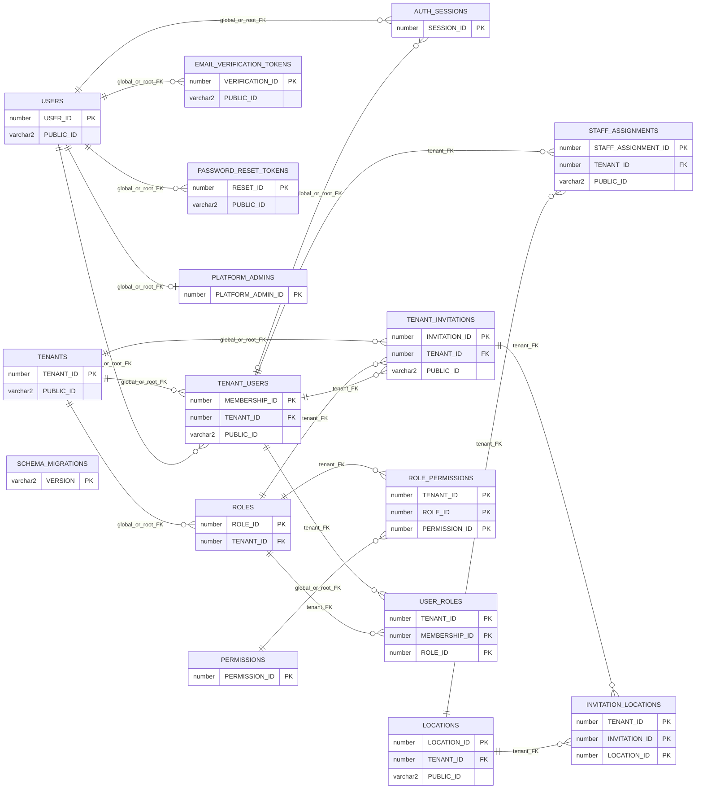

# Platform And Access

Implementation overlay: this remains the **full proposed Step 05 design**, not an installed Step 07 schema. See [implemented SQL versus pending/Oracle-unverified structures](implemented-schema.md).

Proposed MVP logical diagram. Only included tables appear; shared parent context may repeat across diagrams. Exact columns/composite keys, optional checks and source deviations are in [relationships](relationships-and-constraints.md). Lines summarize multiple related FKs; nullable global scopes do not waive the non-null scope guard. Cardinality shown is schema capacity, not proof of required onboarding/item rows.

