# Step 07 scoped schema

**D-18-approved Step 07 SQL structure; installed and verified on the designated Oracle target on 23 November 2026.** This diagram covers the 26 tables in the Step 07 manifest only. It shows key/reference columns and database cardinality; exact column definitions/checks are in the [dictionary](data-dictionary.md), [constraint register](relationships-and-constraints.md) and [SQL inventory](implemented-schema.md). No authentication or authorization behavior is implemented by this diagram.

```mermaid
erDiagram
  SCHEMA_MIGRATIONS {
    varchar2 VERSION PK
    varchar2 REPAIR_VERSION FK
  }
  SPORTS {
    number SPORT_ID PK
  }
  PERMISSIONS {
    number PERMISSION_ID PK
  }
  TENANTS {
    number TENANT_ID PK
    varchar2 PUBLIC_ID
  }
  USERS {
    number USER_ID PK
    varchar2 PUBLIC_ID
  }
  PLATFORM_ADMINS {
    number PLATFORM_ADMIN_ID PK
    number USER_ID FK
  }
  TENANT_USERS {
    number MEMBERSHIP_ID PK
    number TENANT_ID FK
    number USER_ID FK
    number INVITED_BY_MEMBERSHIP_ID FK
    varchar2 PUBLIC_ID
  }
  ROLES {
    number ROLE_ID PK
    number TENANT_ID FK
  }
  ROLE_PERMISSIONS {
    number TENANT_ID PK,FK
    number ROLE_ID PK,FK
    number PERMISSION_ID PK,FK
  }
  USER_ROLES {
    number TENANT_ID PK,FK
    number MEMBERSHIP_ID PK,FK
    number ROLE_ID PK,FK
    number ASSIGNED_BY_MEMBERSHIP_ID FK
  }
  BUSINESSES {
    number BUSINESS_ID PK
    number TENANT_ID FK
    varchar2 PUBLIC_ID
  }
  BUSINESS_PROFILES {
    number BUSINESS_PROFILE_ID PK
    number TENANT_ID FK
    number BUSINESS_ID FK
  }
  LOCATIONS {
    number LOCATION_ID PK
    number TENANT_ID FK
    number BUSINESS_ID FK
    varchar2 PUBLIC_ID
  }
  BUSINESS_SPORTS {
    number TENANT_ID PK,FK
    number BUSINESS_ID PK,FK
    number SPORT_ID PK,FK
  }
  AUTH_SESSIONS {
    number SESSION_ID PK
    number USER_ID FK
    varchar2 TOKEN_HASH
    varchar2 AUDIENCE
    number ACTIVE_TENANT_ID FK
    number ACTIVE_MEMBERSHIP_ID FK
  }
  EMAIL_VERIFICATION_TOKENS {
    number VERIFICATION_ID PK
    number USER_ID FK
    varchar2 TOKEN_HASH
    varchar2 PUBLIC_ID
  }
  PASSWORD_RESET_TOKENS {
    number RESET_ID PK
    number USER_ID FK
    varchar2 TOKEN_HASH
    varchar2 PUBLIC_ID
  }
  RESOURCES {
    number RESOURCE_ID PK
    number TENANT_ID FK
    number BUSINESS_ID FK
    number LOCATION_ID FK
    number SPORT_ID FK
    varchar2 PUBLIC_ID
  }
  RESOURCE_FEATURES {
    number RESOURCE_FEATURE_ID PK
    number TENANT_ID FK
    number RESOURCE_ID FK
  }
  STAFF_ASSIGNMENTS {
    number STAFF_ASSIGNMENT_ID PK
    number TENANT_ID FK
    number MEMBERSHIP_ID FK
    number LOCATION_ID FK
    varchar2 PUBLIC_ID
  }
  TENANT_INVITATIONS {
    number INVITATION_ID PK
    number TENANT_ID FK
    number ROLE_ID FK
    varchar2 TOKEN_HASH
    number INVITED_BY_MEMBERSHIP_ID FK
    varchar2 PUBLIC_ID
  }
  INVITATION_LOCATIONS {
    number TENANT_ID PK,FK
    number INVITATION_ID PK,FK
    number LOCATION_ID PK,FK
  }
  OPERATING_HOURS {
    number OPERATING_HOUR_ID PK
    number TENANT_ID FK
    number LOCATION_ID FK
    number RESOURCE_ID FK
    varchar2 PUBLIC_ID
  }
  HOLIDAYS {
    number HOLIDAY_ID PK
    number TENANT_ID FK
    number LOCATION_ID FK
    varchar2 PUBLIC_ID
  }
  AVAILABILITY_BLOCKS {
    number AVAILABILITY_BLOCK_ID PK
    number TENANT_ID FK
    number LOCATION_ID FK
    number RESOURCE_ID FK
    number CREATED_BY_MEMBERSHIP_ID FK
    varchar2 PUBLIC_ID
  }
  PRICING_RULES {
    number PRICING_RULE_ID PK
    number TENANT_ID FK
    number RESOURCE_ID FK
    varchar2 PUBLIC_ID
  }
  SCHEMA_MIGRATIONS o|--o{ SCHEMA_MIGRATIONS : FK_MIGRATION_REPAIR
  USERS ||--o| PLATFORM_ADMINS : FK_PLATFORM_ADMINS_USER
  TENANTS ||--o{ TENANT_USERS : FK_TENANT_USERS_TENANT
  USERS ||--o{ TENANT_USERS : FK_TENANT_USERS_USER
  TENANT_USERS o|--o{ TENANT_USERS : FK_TENANT_USERS_INVITER
  TENANTS ||--o{ ROLES : FK_ROLES_TENANT
  ROLES ||--o{ ROLE_PERMISSIONS : FK_ROLE_PERMISSIONS_ROLE
  PERMISSIONS ||--o{ ROLE_PERMISSIONS : FK_ROLE_PERMISSIONS_PERMISSION
  TENANT_USERS ||--o{ USER_ROLES : FK_USER_ROLES_MEMBERSHIP
  ROLES ||--o{ USER_ROLES : FK_USER_ROLES_ROLE
  TENANT_USERS o|--o{ USER_ROLES : FK_USER_ROLES_ASSIGNER
  TENANTS ||--o| BUSINESSES : FK_BUSINESSES_TENANT
  BUSINESSES ||--o| BUSINESS_PROFILES : FK_BUSINESS_PROFILES_BUSINESS
  BUSINESSES ||--o{ LOCATIONS : FK_LOCATIONS_BUSINESS
  BUSINESSES ||--o{ BUSINESS_SPORTS : FK_BUSINESS_SPORTS_BUSINESS
  SPORTS ||--o{ BUSINESS_SPORTS : FK_BUSINESS_SPORTS_SPORT
  USERS ||--o{ AUTH_SESSIONS : FK_AUTH_SESSIONS_USER
  TENANT_USERS o|--o{ AUTH_SESSIONS : FK_SESSION_ACTIVE_MEMBER
  USERS ||--o{ EMAIL_VERIFICATION_TOKENS : FK_EMAIL_VERIFICATION_USER
  USERS ||--o{ PASSWORD_RESET_TOKENS : FK_PASSWORD_RESET_USER
  BUSINESSES ||--o{ RESOURCES : FK_RESOURCES_BUSINESS
  LOCATIONS ||--o{ RESOURCES : FK_RESOURCES_LOCATION
  BUSINESS_SPORTS ||--o{ RESOURCES : FK_RESOURCES_BUSINESS_SPORT
  RESOURCES ||--o{ RESOURCE_FEATURES : FK_RESOURCE_FEATURES_RESOURCE
  TENANT_USERS ||--o{ STAFF_ASSIGNMENTS : FK_STAFF_MEMBER
  LOCATIONS ||--o{ STAFF_ASSIGNMENTS : FK_STAFF_ASSIGNMENTS_LOCATION
  TENANTS ||--o{ TENANT_INVITATIONS : FK_TENANT_INVITATIONS_TENANT
  ROLES ||--o{ TENANT_INVITATIONS : FK_TENANT_INVITATIONS_ROLE
  TENANT_USERS ||--o{ TENANT_INVITATIONS : FK_TENANT_INVITATIONS_INVITER
  TENANT_INVITATIONS ||--o{ INVITATION_LOCATIONS : FK_IL_INVITATION
  LOCATIONS ||--o{ INVITATION_LOCATIONS : FK_IL_LOCATION
  LOCATIONS ||--o{ OPERATING_HOURS : FK_OPERATING_HOURS_LOCATION
  RESOURCES o|--o{ OPERATING_HOURS : FK_OPERATING_HOURS_RESOURCE
  LOCATIONS ||--o{ HOLIDAYS : FK_HOLIDAYS_LOCATION
  LOCATIONS ||--o{ AVAILABILITY_BLOCKS : FK_AVAIL_LOC
  RESOURCES o|--o{ AVAILABILITY_BLOCKS : FK_AVAIL_RESOURCE
  TENANT_USERS ||--o{ AVAILABILITY_BLOCKS : FK_AVAILABILITY_BLOCKS_CREATOR
  RESOURCES ||--o{ PRICING_RULES : FK_PRICING_RULES_RESOURCE
```

An optional FK can be absent; tenant and location anchors still enforce required ownership. AUTH_SESSIONS additionally requires both membership-context fields or neither, and matches the session user through its composite membership FK. One business per tenant is a unique-key limit; requiring a business for every tenant remains onboarding behavior. No cascading deletion is introduced.
