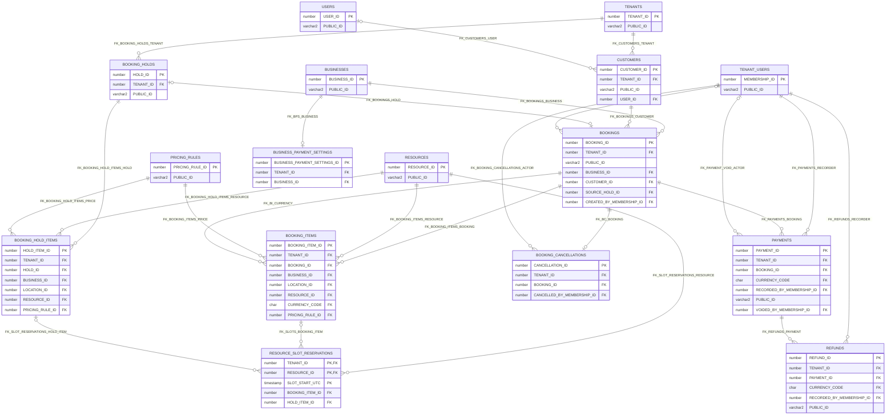

# Step 08 booking and venue finance schema draft

**D-21-approved schema installed and verified on Oracle under D-22.** The six original Step 07 parent structures shown here are already installed; the ten new tables are now installed/catalog-verified as well. Exact columns/checks/indexes, including PENDING_PAYMENT, zero-value PAID and conditional successful-receipt/refund uniqueness, are in the dictionary/register and [Step 08 record](step08-verification.md). No application booking/payment workflow is implemented.

Conditional unique UX_BOOKINGS_SOURCE_HOLD prevents two non-null conversions while allowing repeated manual bookings with no source hold. REFUNDS links to PAYMENTS and its currency; booking identity is derived through the payment, without an independently mutable refund booking ID. Slot ownership includes the exact same tenant/resource/item tuple.
