# Step 09 scoped storage ERD

**D-24-approved structure installed and catalog-verified on Oracle under D-27.** Existing parent tables are shown for scope only; [verification record](step09-verification.md) separates installed and proposed structures. DOMAINS and notification tables are excluded.

```mermaid
erDiagram
    TENANTS {
        number TENANT_ID
        varchar2 PUBLIC_ID
    }
    USERS {
        number USER_ID
        varchar2 PUBLIC_ID
    }
    PLATFORM_ADMINS {
        number PLATFORM_ADMIN_ID
        number USER_ID
    }
    TENANT_USERS {
        number MEMBERSHIP_ID
        number TENANT_ID
        number USER_ID
        number INVITED_BY_MEMBERSHIP_ID
        varchar2 PUBLIC_ID
    }
    BUSINESSES {
        number BUSINESS_ID
        number TENANT_ID
        varchar2 PUBLIC_ID
    }
    LOCATIONS {
        number LOCATION_ID
        number TENANT_ID
        number BUSINESS_ID
        varchar2 PUBLIC_ID
    }
    RESOURCES {
        number RESOURCE_ID
        number TENANT_ID
        number BUSINESS_ID
        number LOCATION_ID
        number SPORT_ID
        varchar2 PUBLIC_ID
    }
    SUBSCRIPTION_PLANS {
        number PLAN_ID
    }
    SUBSCRIPTION_ENTITLEMENTS {
        number PLAN_ID
        varchar2 FEATURE_CODE
        varchar2 VALUE_KIND
    }
    SUBSCRIPTIONS {
        number SUBSCRIPTION_ID
        number TENANT_ID
        number PLAN_ID
    }
    SUBSCRIPTION_FEATURE_SNAPSHOTS {
        number TENANT_ID
        number SUBSCRIPTION_ID
        varchar2 FEATURE_CODE
        varchar2 VALUE_KIND
    }
    SUBSCRIPTION_INVOICES {
        number SUBSCRIPTION_INVOICE_ID
        number TENANT_ID
        number SUBSCRIPTION_ID
    }
    SUBSCRIPTION_PAYMENTS {
        number SUBSCRIPTION_PAYMENT_ID
        number TENANT_ID
        number SUBSCRIPTION_INVOICE_ID
        number RECORDED_BY_USER_ID
        varchar2 PUBLIC_ID
        number VOIDED_BY_USER_ID
        number RECORDED_BY_PLATFORM_ADMIN_ID
        number VOIDED_BY_PLATFORM_ADMIN_ID
    }
    WEBSITE_THEMES {
        number THEME_ID
    }
    WEBSITE_SETTINGS {
        number WEBSITE_ID
        number TENANT_ID
        number BUSINESS_ID
        number THEME_ID
        varchar2 SUBDOMAIN_SLUG
        varchar2 PUBLIC_ID
    }
    WEBSITE_MEDIA {
        number WEBSITE_MEDIA_ID
        number TENANT_ID
        number BUSINESS_ID
        number LOCATION_ID
        number RESOURCE_ID
        varchar2 PUBLIC_ID
    }
    AUDIT_LOGS {
        number AUDIT_LOG_ID
        number TENANT_ID
        number ACTOR_USER_ID
        number ACTOR_MEMBERSHIP_ID
        varchar2 ENTITY_PUBLIC_ID
        varchar2 REQUEST_ID
        varchar2 PUBLIC_ID
        varchar2 SCOPE_KIND
        number ACTOR_PLATFORM_ADMIN_ID
    }
    OUTBOX_EVENTS {
        number OUTBOX_EVENT_ID
        number TENANT_ID
        varchar2 AGGREGATE_ID
        varchar2 SCOPE_KIND
    }
    JOB_QUEUE {
        number JOB_ID
        number TENANT_ID
        varchar2 SCOPE_KIND
        varchar2 LEASE_TOKEN
        number SOURCE_OUTBOX_EVENT_ID
        varchar2 CONSUMER_CODE
    }
    IDEMPOTENCY_KEYS {
        number IDEMPOTENCY_ID
        number TENANT_ID
        varchar2 OPERATION_SCOPE
        varchar2 OWNER_SCOPE
        varchar2 EXECUTION_STATUS
        varchar2 LEASE_TOKEN
        varchar2 SCOPE_KIND
    }
    SUBSCRIPTION_PLANS ||--o{ SUBSCRIPTION_ENTITLEMENTS : FK_SE_PLAN
    TENANTS ||--o{ SUBSCRIPTIONS : FK_SUBSCRIPTIONS_TENANT
    SUBSCRIPTION_PLANS ||--o{ SUBSCRIPTIONS : FK_SUBSCRIPTIONS_PLAN
    SUBSCRIPTIONS ||--o{ SUBSCRIPTION_INVOICES : FK_SI_SUBSCRIPTION
    USERS ||--o{ SUBSCRIPTION_PAYMENTS : FK_SUBSCRIPTION_PAYMENTS_USER
    USERS ||--o{ SUBSCRIPTION_PAYMENTS : FK_SP_VOID_USER
    SUBSCRIPTION_INVOICES ||--o{ SUBSCRIPTION_PAYMENTS : FK_SP_INVOICE
    PLATFORM_ADMINS ||--o{ SUBSCRIPTION_PAYMENTS : FK_SP_ADMIN_ACTOR
    PLATFORM_ADMINS ||--o{ SUBSCRIPTION_PAYMENTS : FK_SP_VOID_ADMIN
    BUSINESSES ||--o{ WEBSITE_SETTINGS : FK_WEBSITE_SETTINGS_BUSINESS
    WEBSITE_THEMES ||--o{ WEBSITE_SETTINGS : FK_WEBSITE_SETTINGS_THEME
    BUSINESSES ||--o{ WEBSITE_MEDIA : FK_WEBSITE_MEDIA_BUSINESS
    LOCATIONS ||--o{ WEBSITE_MEDIA : FK_WEBSITE_MEDIA_LOCATION
    RESOURCES ||--o{ WEBSITE_MEDIA : FK_WEBSITE_MEDIA_RESOURCE
    TENANTS ||--o{ OUTBOX_EVENTS : FK_OUTBOX_EVENTS_TENANT
    TENANTS ||--o{ JOB_QUEUE : FK_JOB_QUEUE_TENANT
    OUTBOX_EVENTS ||--o{ JOB_QUEUE : FK_JOB_EVENT_SCOPE
    OUTBOX_EVENTS ||--o{ JOB_QUEUE : FK_JOB_EVENT_TENANT
    TENANTS ||--o{ IDEMPOTENCY_KEYS : FK_IDEMPOTENCY_KEYS_TENANT
    TENANTS ||--o{ AUDIT_LOGS : FK_AUDIT_LOGS_TENANT
    USERS ||--o{ AUDIT_LOGS : FK_AUDIT_LOGS_USER
    TENANT_USERS ||--o{ AUDIT_LOGS : FK_AUDIT_LOGS_MEMBERSHIP_ACTOR
    PLATFORM_ADMINS ||--o{ AUDIT_LOGS : FK_AUDIT_ADMIN_USER
    SUBSCRIPTIONS ||--o{ SUBSCRIPTION_FEATURE_SNAPSHOTS : FK_SFS_SUBSCRIPTION
```

Row CHECKs do not implement authorization, immutable-history enforcement against owners, aggregate payment caps, interval exclusion, safe payload schemas or production processing.
